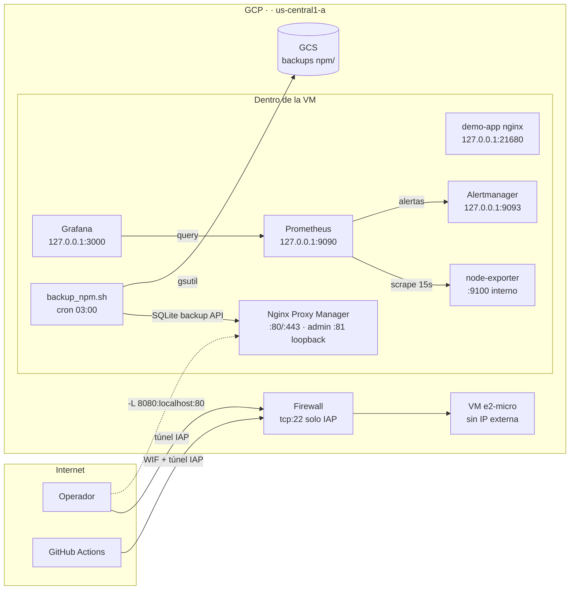

# 🚀 GCP DevOps Infrastructure Automation

Laboratorio de infraestructura como código en Google Cloud Platform, diseñado
para el **Always Free Tier real**: una instancia `e2-micro` (1 GB de RAM, 30 GB
de disco `pd-standard`) provisionada con **Terraform**, configurada con
**Ansible** y validada por un pipeline de **GitHub Actions**.

El perfil por defecto **no crea IP externa, ni snapshots, ni VPC Flow Logs**:
todo se accede por túneles IAP, que son gratuitos. El coste mensual es **0,00
USD**. La única excepción es una ventana temporal de salida a Internet
(`enable_egress`) para que `apt` y `docker pull` funcionen durante el despliegue:
no abre ningún puerto entrante y se cierra al terminar.

El objetivo no es solo que funcione, sino que sea reproducible, observable y
recuperable: firewalls mínimos, secretos fuera del repositorio, backups
verificados y un despliegue que falla si los servicios no quedan sanos.

## 🛠️ Stack

| Capa | Tecnología |
|---|---|
| Nube | GCP · `e2-micro` · Ubuntu 22.04 · disco `pd-standard` 30 GB |
| Infraestructura | Terraform ≥ 1.9 (provider `hashicorp/google` 6.x) |
| Configuración | Ansible (`site.yml` como entrada única) |
| Contenedores | Docker Engine + Docker Compose v2 |
| Proxy / TLS | Nginx Proxy Manager 2.16.0 |
| Observabilidad | Prometheus v3.15.0 · Grafana 13.2.3 · Alertmanager v0.34.1 · node-exporter v1.12.1 |
| CI/CD | GitHub Actions (Workload Identity Federation + túnel IAP) |
| Backups | SQLite backup API → GCS (opcional) + retención local |
| Acceso | IAP para SSH, web, Grafana, Prometheus y NPM admin |

## 🏗️ Arquitectura



- **Tres capas separadas:** Terraform no configura servicios y Ansible no crea
  infraestructura. El pipeline solo ejecuta Ansible.
- **Público por defecto:** nada. Solo IAP.
- **Paneles admin** (NPM 81, Grafana 3000, Prometheus 9090, Alertmanager 9093)
  escuchan en `127.0.0.1` y se acceden por túnel IAP.
- **Sin claves de servicio en disco:** la VM usa su service account; el pipeline
  usa WIF.

### Exposición de red

| Puerto | Origen permitido | Servicio | Cómo se accede |
|---|---|---|---|
| 22 | Solo `35.235.240.0/20` (IAP) | sshd | `gcloud compute ssh --tunnel-through-iap` |
| 80, 443 | Solo túnel/loopback | NPM | Túnel IAP `-L 8080:localhost:80` |
| 81 | Loopback | NPM admin | Túnel IAP `-L 8081:localhost:81` |
| 3000 | Loopback | Grafana | Túnel IAP `-L 3000:localhost:3000` |
| 9090 | Loopback | Prometheus | Túnel IAP `-L 9090:localhost:9090` |
| 9093 | Loopback | Alertmanager | Túnel IAP `-L 9093:localhost:9093` |
| 21680 | Loopback | Demo app | A través de NPM |
| 9100 | Red interna de Compose | node-exporter | Solo lo scrapea Prometheus |

## ⚡ Quick start

Requisitos: `gcloud`, Terraform ≥ 1.9, `ansible-core` ≥ 2.17, Python 3.10+,
Docker (solo para validar los compose en local) y una clave ED25519 en
`~/.ssh/id_deploy_gcp`.

```bash
# 1. Configuración local (nunca commitear estos archivos)
gcloud auth login
gcloud auth application-default login
gcloud config set project <TU_PROYECTO>
cp terraform.tfvars.example terraform.tfvars   # edita project_id
cp .env.example .env                           # solo para validar compose en local
ansible-galaxy collection install -r requirements.yml

# 2. Infraestructura: revisar siempre el plan antes de aplicar
make init
make plan
terraform show tfplan        # ¿algún recurso de pago? ¿algún "must be replaced"?
make apply

# 3. Secretos (0600, gitignored)
cat > secrets.yml <<'YAML'
grafana_admin_password: "cambia-esto-por-una-contrasena-larga"
YAML
chmod 600 secrets.yml

# 4. Ventana de egress: sin salida a Internet, apt y docker pull fallan
make egress-on
make deploy                  # abre túnel IAP, ejecuta site.yml y lo cierra
make egress-off              # vuelve al perfil 0,00 USD
```

`make deploy` comprueba que la ventana de egress está abierta, levanta el túnel
IAP en `127.0.0.1:2222`, ejecuta `site.yml` con `-e @secrets.yml` (si existe) y
cierra el túnel con `trap` incluso si Ansible falla. Para un bloque concreto:

```bash
make deploy ARGS="--tags verify"    # o --check para un dry-run
```

> ⚠️ **No hay backend remoto de Terraform.** El estado es local
> (`terraform.tfstate`). Haz copia antes de operar (ver `docs/OPERACION.md`). El
> estado del proyecto anterior está archivado en
> `.local/state-backups/deleted-project/` y **no** debe reutilizarse.

## 📚 Documentación

| Documento | Contenido |
|---|---|
| [`docs/FREE-TIER.md`](docs/FREE-TIER.md) | Límites de Always Free, ventana de egress, checklist de facturación |
| [`docs/OPERACION.md`](docs/OPERACION.md) | Puesta en marcha, día a día, versiones, backups, Terraform seguro y troubleshooting |
| [`docs/runbooks/alerting.md`](docs/runbooks/alerting.md) | Qué hacer ante cada alerta |
| [`docs/runbooks/disaster-recovery.md`](docs/runbooks/disaster-recovery.md) | Restauración de la base de datos y reconstrucción de la instancia |
| [`CHANGELOG.md`](CHANGELOG.md) | Historial de cambios relevantes |

## 💸 Coste

| Concepto | Perfil gratuito | Ventana de egress |
|---|---|---|
| `e2-micro` + 30 GB `pd-standard` | 0,00 USD | 0,00 USD |
| IP externa | no se crea | efímera; ~$0,005/hora (1 h/mes gratis) |
| Snapshots | no se crean | no se crean |
| VPC Flow Logs | desactivados | desactivados |
| Egress | 1 GB/mes gratis | 1 GB/mes gratis; después `$0.12/GiB` |
| Backup GCS | dentro de 5 GB gratis | dentro de 5 GB gratis |

Una ventana típica de despliegue cuesta entre **0,00 y 0,02 USD**. Dejarla
abierta 24/7 costaría ≈ `$3,65/mes`, por eso `make egress-off` forma parte del
flujo. Detalle y verificación en [`docs/FREE-TIER.md`](docs/FREE-TIER.md).

## 🛡️ Continuidad de negocio

| Capa | Qué cubre | Frecuencia | Retención | Coste |
|---|---|---|---|---|
| Backup SQLite (API de backup + `integrity_check`) | Configuración de NPM | Diario 03:00 | 7 días · local + GCS | Gratis (5 GB) |

**RPO 24 h / RTO ~30 min** para la base de datos. No hay snapshots de disco: la
reconstrucción completa es Terraform + Ansible y restaurar la base de datos
desde GCS. Restauración paso a paso en
[`docs/runbooks/disaster-recovery.md`](docs/runbooks/disaster-recovery.md).

## ⚙️ Optimización para 1 GB

- **Swap 2 GB** con `vm.swappiness=10`: usa RAM primero y disco solo bajo
  presión; persistente en `/etc/fstab`.
- **Límites de memoria por contenedor** que suman 712 MiB, medidos con
  `docker stats` (consumo real en reposo ~330 MiB).
- **Sin cAdvisor:** su sondeo de metadatos llevaba el disco `pd-standard` a
  ~90 % de io-wait. Al retirarlo bajó a ~1.3 %. node-exporter cubre las métricas
  del host.
- **Grafana fuera de los recreate automáticos:** su arranque cuesta ~20 min.

## 🔁 Pipeline CI/CD

`quality.yml` corre en cada push/PR y no toca la nube: `terraform fmt/validate`,
gate de free tier, checkov, ansible-lint, yamllint, `docker compose config`,
drift del dashboard, validación de reglas de Prometheus y de la plantilla de
Alertmanager, y actionlint.

`main.yml` despliega en push a `main` (o manual) **solo Ansible**, por túnel IAP.
Configura en *Settings → Secrets and variables → Actions*:

| Tipo | Nombre | Valor |
|---|---|---|
| Secret | `GCP_WORKLOAD_IDENTITY_PROVIDER` | `projects/<num>/locations/global/workloadIdentityPools/<pool>/providers/<provider>` |
| Secret | `GCP_SERVICE_ACCOUNT` | Email de la SA de despliegue |
| Secret | `SSH_PRIVATE_KEY` | Clave privada ED25519 de `ubuntu` |
| Secret | `GF_SECURITY_ADMIN_PASSWORD` | Password inicial de Grafana |
| Variable | `GCP_PROJECT_ID` | `<TU_PROYECTO>` |
| Variable | `GCP_INSTANCE_NAME` | `instancia-devops-gcp` |
| Variable | `GCP_ZONE` | `us-central1-a` |
| Variable | `GCP_USER` | `ubuntu` |
| Variable | `BACKUP_BUCKET` | Nombre del bucket o vacío (opcional) |

Notas: el timeout es de **90 minutos** porque Grafana tarda 18-27 min en arrancar
en una e2-micro. `BACKUP_BUCKET` activa la copia off-site; sin ella el backup
local sigue funcionando, pero no hay DRP. `Alertmanager` entrega a un receiver
`null` hasta que se configure `alertmanager_webhook_url` (opcional). Si la
ventana de egress no está abierta en el momento del push, el deploy de CI falla
en `apt`: ábrela antes con `make egress-on`.

## 👨‍💻 Autor

Orlando Domínguez M. — [MIT License](LICENSE)
