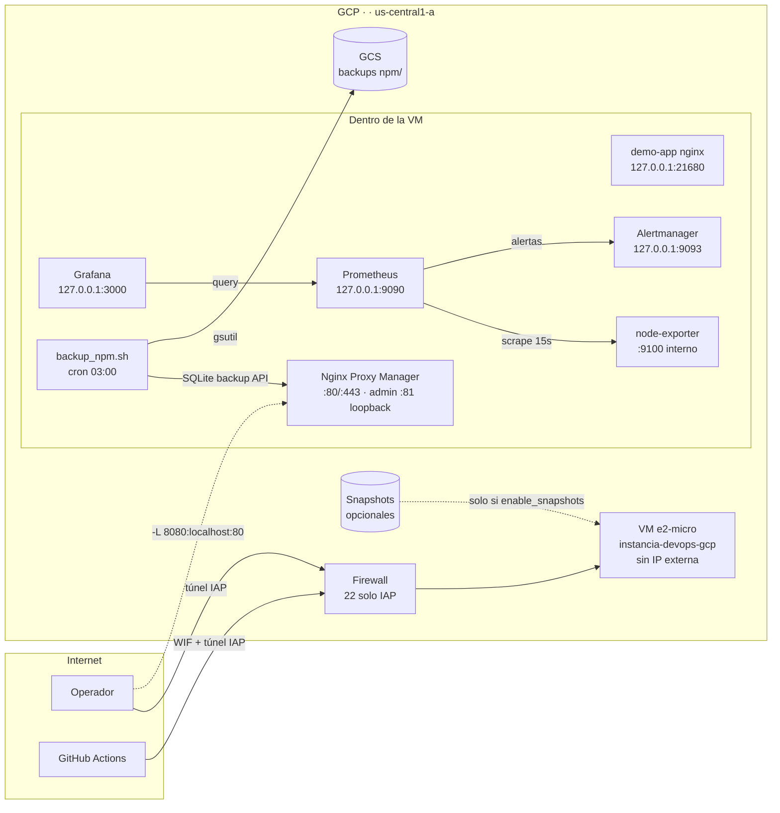
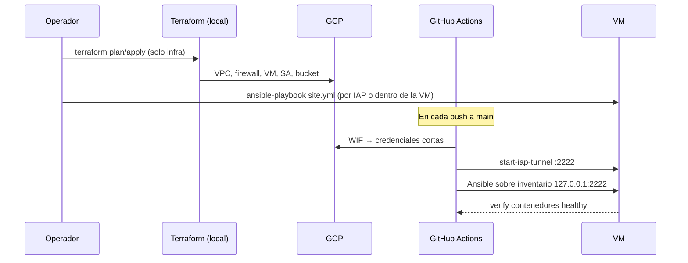

# Arquitectura

> Última revisión: 2026-11-13. Describe cómo encajan las piezas y **por qué**
> están así. El inventario de archivos está en [`ESTRUCTURA.md`](ESTRUCTURA.md)
> y los límites de facturación en [`FREE-TIER.md`](FREE-TIER.md).

## 1. Resumen

Laboratorio DevOps de una sola instancia en GCP, dimensionado para el *Always
Free Tier* real: `e2-micro`, 1 GB de RAM, 30 GB de disco `pd-standard`, sin IP
externa y sin snapshots por defecto. Tres capas claramente separadas:

| Capa | Herramienta | Responsabilidad | Dónde se ejecuta |
|---|---|---|---|
| Infraestructura | Terraform | Red, firewall, VM, SA, bucket y snapshots opcionales | **Local** (operador) |
| Configuración | Ansible | Swap, Docker, stacks, backups, hardening, verificación | **Dentro de la VM** o desde CI por túnel IAP |
| Servicios | Docker Compose | NPM, demo, Prometheus, Grafana, Alertmanager | En la VM |

La regla que ordena todo: **Terraform no configura servicios y Ansible no crea
infraestructura**. El pipeline de GitHub Actions solo ejecuta Ansible.

## 2. Diagrama

Perfil por defecto (`enable_public_ip = false`):



Con `enable_public_ip = true` se añade una IP estática y una regla 80/443. Es el
único cambio de arquitectura y el único coste fijo (≈ `$3,65/mes`).

Acceso de administración y web en el perfil gratuito:

```bash
gcloud compute ssh instancia-devops-gcp --tunnel-through-iap \
  --zone us-central1-a \
  -L 8080:localhost:80 -L 3000:localhost:3000 -L 9090:localhost:9090 \
  -L 8081:localhost:81 -L 9093:localhost:9093
```

## 3. Componentes

### Infraestructura (Terraform)

- **VPC** `vpc-devops-lab` + subnet `subnet-devops` `10.0.1.0/24`. VPC Flow Logs
  desactivados por defecto (`enable_vpc_flow_logs = false`) porque se facturan
  por GiB.
- **IP estática:** solo se crea con `enable_public_ip = true`. En el perfil
  gratuito no existe ninguna dirección reservada, ni en uso ni sin usar.
- **Firewall:** `allow-ssh-iap` (tcp:22 solo desde `35.235.240.0/20`).
  `allow-web` (80/443) solo se crea con `enable_public_ip = true`.
- **VM** e2-micro, Ubuntu 22.04, disco `pd-standard` 30 GB, Shielded VM
  opcional (`false` por política de organización), `deletion_protection` activo,
  `block-project-ssh-keys=true`, SA dedicada `devops-backup`. Sin
  `access_config` no hay IP externa.
- **Bucket** de backups (`backup_bucket_name`, opcional): UBLA, acceso público
  bloqueado, versioning, lifecycle 7 días y expiración rápida de versiones no
  vigentes. La VM solo tiene `roles/storage.objectCreator`. Debe estar en
  `us-central1`, `us-west1` o `us-east1`, en la misma región que la VM.
- **Snapshot diario** (`enable_snapshots`, por defecto `false`): 04:00 UTC,
  retención 7 días, `KEEP_AUTO_SNAPSHOTS`. Es la única capa fuera de Always Free.

### Configuración (Ansible)

Orden de `site.yml`, que no es casual:

1. **`swap`** — sin 2 GB de swap, el resto del play puede morir por OOM en 1 GB.
2. **`docker`** — limpia sources APT legacy antes de cualquier `apt update`
   (si no, APT falla por `Signed-By` en conflicto), instala Engine + Compose v2.
3. **`stacks`** — crea directorios, renderiza `.env` (0600, `no_log`), copia
   **solo definiciones**, detecta cambios por fingerprint y recrea únicamente
   `prometheus` y `alertmanager` cuando su configuración cambió. Grafana queda
   fuera a propósito: un recreate forzado cuesta ~20 minutos.
4. **`backups`** — instala el script, ejecuta una prueba real y crea el cron.
   Si `backup_bucket` está definido, instala `google-cloud-cli` (para `gsutil`)
   y comprueba que el objeto llegó al bucket; si no, el backup queda solo local.
5. **`hardening`** — último y con `reload`, no `restart`: aplica SSH sin cortar
   la conexión que ejecuta el play. Si `sshd -t` falla, hace rollback.
6. **`verify`** (siempre) — exige los 6 contenedores esperados, espera hasta
   300 s a que estén `healthy` y reporta swap.

`group_vars/all/main.yml` es la fuente única de verdad. La lista
`compose_stacks` declara explícitamente **qué archivo es definición y cuál es
dato**; eso es lo que evita que un `synchronize` borre la base de datos de NPM.

### Servicios (Docker Compose)

| Stack | Servicio | Puerto | Persistencia |
|---|---|---|---|
| `proxy` | Nginx Proxy Manager 2.16.0 | 80/443 en el host; 81 loopback | `proxy/data`, `proxy/letsencrypt` |
| `app` | nginx demo | `127.0.0.1:21680` | `app/html` (solo lectura) |
| `monitoring` | Prometheus v3.15.0 | `127.0.0.1:9090` | volumen `prometheus_data` |
| `monitoring` | Grafana 13.2.3 | `127.0.0.1:3000` | volumen `grafana_data` |
| `monitoring` | Alertmanager v0.34.1 | `127.0.0.1:9093` | volumen `alertmanager_data` |
| `monitoring` | node-exporter v1.12.1 | `9100` interno | ninguno (read-only) |

## 4. Exposición de red

Perfil gratuito:

| Puerto | Origen permitido | Servicio | Cómo se accede |
|---|---|---|---|
| 22 | Solo `35.235.240.0/20` (IAP) | sshd | `gcloud compute ssh --tunnel-through-iap` |
| 80, 443 | Solo loopback/túnel | NPM | Túnel IAP `-L 8080:localhost:80` |
| 81 | Loopback de la VM | NPM admin | Túnel IAP `-L 8081:localhost:81` |
| 3000 | Loopback | Grafana | Túnel IAP `-L 3000:localhost:3000` |
| 9090 | Loopback | Prometheus | Túnel IAP `-L 9090:localhost:9090` |
| 9093 | Loopback | Alertmanager | Túnel IAP `-L 9093:localhost:9093` |
| 21680 | Loopback | Demo app | A través de NPM |
| 9100 | Red interna de Compose | node-exporter | Solo lo scrapea Prometheus |

Con `enable_public_ip = true`, 80/443 pasan a aceptar `web_source_ranges`
(`0.0.0.0/0` por defecto). Los binds a `127.0.0.1` siguen siendo una segunda
barrera: aunque el firewall se abriera por error, el puerto rechaza conexiones
externas.

## 5. Flujo de despliegue



Dos formas de ejecutar Ansible, y no son intercambiables:

1. **Desde el operador por túnel IAP** (recomendada para el primer despliegue):
   inventario con `ansible_host=127.0.0.1 ansible_port=2222` y `--private-key`.
   Una VM nueva no tiene el repositorio, así que este es el único modo que
   funciona sin copiarlo antes. Es lo que hace `main.yml`.
2. **Dentro de la VM** (cómoda para operar después): `hosts.ini` usa
   `ansible_connection=local`, pero exige haber clonado el repositorio en la VM.
   Requiere `ANSIBLE_COLLECTIONS_PATH` para no usar las colecciones antiguas del
   sistema.

## 6. Modelo de seguridad

- **Sin SSH público.** Solo IAP; la clave se inyecta al crear la VM y
  `block-project-ssh-keys` impide claves de todo el proyecto.
- **Sin IP externa por defecto.** La superficie pública es cero; se elimina el
  coste de la IP y el riesgo de exposición accidental.
- **Sin claves de servicio en disco.** La VM usa su service account vía
  metadata server. El pipeline usa Workload Identity Federation (sin JSON).
- **Mínimo privilegio en backups.** `objectCreator` sobre un bucket: puede crear,
  no leer ni borrar. La retención la aplica el lifecycle del bucket.
- **Secretos fuera del repo.** `grafana_admin_password` no tiene default y el
  play falla si falta; el `.env` se renderiza 0600 con `no_log`.
- **SSH endurecido:** solo clave, sin root, algoritmos modernos, `MaxAuthTries 3`,
  validación con `sshd -t` + rollback + verificación con `sshd -T`.
- **CI:** escaneo de claves privadas, de `.env` versionado, checkov, tflint,
  ansible-lint, yamllint y actionlint.
- **Deuda conocida:** no hay backend remoto de Terraform; el estado local es un
  punto único de fallo. Ver §10.

## 7. Presupuesto de memoria (1 GB)

Los límites son techos, no reservas. La suma es deliberada para que el OOM
killer del kernel no elija víctimas por su cuenta.

| Servicio | Medido | Límite |
|---|---|---|
| Grafana | ~145 MiB | 288 MiB |
| Prometheus | ~46 MiB | 192 MiB |
| Nginx Proxy Manager | ~30 MiB | 128 MiB |
| Alertmanager | ~18 MiB | 48 MiB |
| node-exporter | ~14 MiB | 32 MiB |
| demo-app nginx | ~1 MiB | 24 MiB |
| **Total** | **~330 MiB** | **712 MiB** |

El resto queda para kernel, systemd, sshd, dockerd y journald, con 2 GB de swap
como red de seguridad para picos, no como memoria de trabajo.

## 8. Backups y continuidad

Dos capas independientes porque cubren fallos distintos:

| Capa | Qué protege | Cuándo | Retención | Coste |
|---|---|---|---|---|
| Backup SQLite | Configuración de NPM (proxy hosts, certificados, usuarios) | Diario 03:00 | 7 días | Gratis dentro de 5 GB |
| Snapshot de disco (opcional) | Instancia completa: volúmenes Docker, `/etc`, OS | Diario 04:00 UTC | 7 días | ≈ 1 USD/mes |

- El backup usa la **API de backup de SQLite**, no `cp`, y valida con
  `PRAGMA integrity_check`.
- `flock` evita solapamientos si el cron se retrasa.
- **RPO 24 h / RTO ~30 min** para la base de datos.
- Sin snapshots (perfil gratuito), la reconstrucción es Terraform + Ansible y
  restaurar la base de datos desde GCS. El procedimiento está en
  [`runbooks/disaster-recovery.md`](runbooks/disaster-recovery.md).

## 9. Observabilidad

- Prometheus scrapea cada 15 s: él mismo, node-exporter y Alertmanager.
- Retención doble: 15 días **y** 2 GB (lo que llegue primero).
- Alertas por grupos:
  - `availability`: `TargetDown`, `PrometheusConfigReloadFailed`, `Watchdog`.
  - `resources`: memoria >85 %/>95 %, swap >50 %, disco <15 %/<5 %, load15.
  - `capacity`: cardinalidad >5000 series.
- `Watchdog` siempre dispara: es el *dead man's switch*. Si deja de llegar,
  el problema es el propio sistema de alertas.
- Alertmanager entrega a un receiver `"null"` (descarta) si no hay webhook. Con
  `alertmanager_webhook_url` cambia a Slack/Discord compatible. Las alertas
  `info` nunca se envían. Las reglas de inhibición evitan tormentas cuando una
  causa común (TargetDown, memoria crítica) dispara varias alertas a la vez.
- Grafana se aprovisiona por código (datasources + provider de dashboards). El
  dashboard se genera con `build_dashboard.py`, no incluye paneles de cAdvisor
  (no desplegado) y CI falla si el JSON no coincide.

## 10. Decisiones registradas

| Decisión | Motivo | Consecuencia |
|---|---|---|
| Sin IP externa por defecto | La IP no entra en Always Free: ≈ `$3,65/mes` | Todo va por IAP; para 80/443 públicos, `enable_public_ip = true` |
| Snapshots desactivados por defecto | No están cubiertos por Always Free | DRP de instancia completa es opt-in (≈ `$1/mes`) |
| VPC Flow Logs desactivados | Se facturan por GiB | Se activan cuando la auditoría vale el coste |
| Validaciones de región/tipo/disco | Evitan convertir el lab en facturable por error | `terraform plan` falla si se sale del free tier |
| SSH solo por IAP | Elimina la superficie pública de SSH | Hay que usar túnel; el pipeline lo levanta |
| SA dedicada de backup con `objectCreator` | La SA por defecto es compartida, suele ser Editor y no permite deshabilitar claves | La VM no puede leer ni borrar sus backups |
| `pd-standard` y no `pd-balanced` | Único disco free tier; además el io-wait de ~90 % lo causaba cAdvisor, no el disco | Cambiar el tipo de disco fuerza reemplazo y factura |
| cAdvisor fuera | I/O de metadatos constante sobre disco de red | Se pierden métricas por contenedor; node-exporter cubre el host |
| Alertmanager presente | Sin él, Prometheus evaluaba reglas y las descartaba | El receiver por defecto descarta, pero el pipeline es verificable |
| Grafana fuera del recreate automático | Su arranque tarda 18-27 min en e2-micro | Cambios de dashboard se aplican por provisioning (30 s), no recreando |
| `pull: missing` | `always` hacía fallar el deploy por timeouts de Docker Hub bajo carga | No detecta un tag re-subido con otro contenido |
| Estado Terraform local (sin backend) | No se configuró `backend` | **Riesgo:** sin bloqueo ni copia remota; no borrar el `.tfstate` |

## 11. Estado actual (2026-11-13)

- El proyecto anterior (`devops-lab-orlando`) fue eliminado de la cuenta. No hay
  infraestructura viva que importar.
- El repositorio queda preparado para un **proyecto nuevo**: `terraform.tfvars`
  con placeholder, bucket vacío, perfil gratuito y estado anterior archivado en
  `.local/state-backups/deleted-project/`.
- `git`: `66380b9` está **1 commit por delante de `origin/main`** y hay cambios
  de esta revisión sin commitear.
- GitHub Actions: `quality.yml` puede correr ya; `main.yml` necesita los secrets
  y variables del repositorio (ver [`EJECUCION.md`](EJECUCION.md)).
- Pendientes: backend remoto de Terraform, rotación de la contraseña de Grafana
  cuando exista un despliegue nuevo y prueba end-to-end en el proyecto nuevo.
  Detalle en [`ESTRUCTURA.md`](ESTRUCTURA.md#5-hallazgos-de-la-revisión-2026-11-13).
